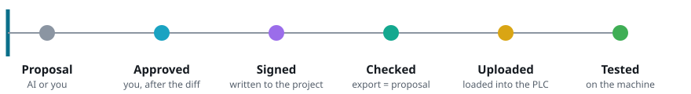
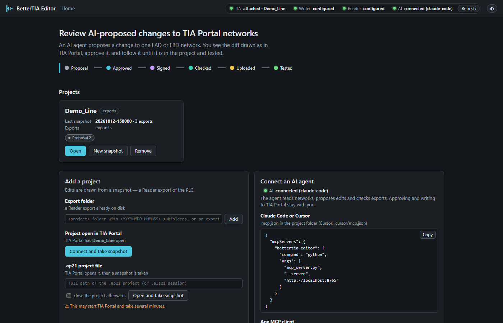
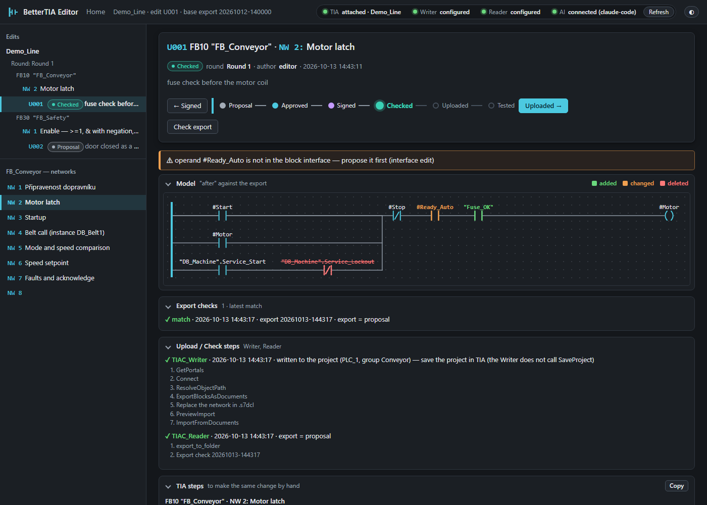
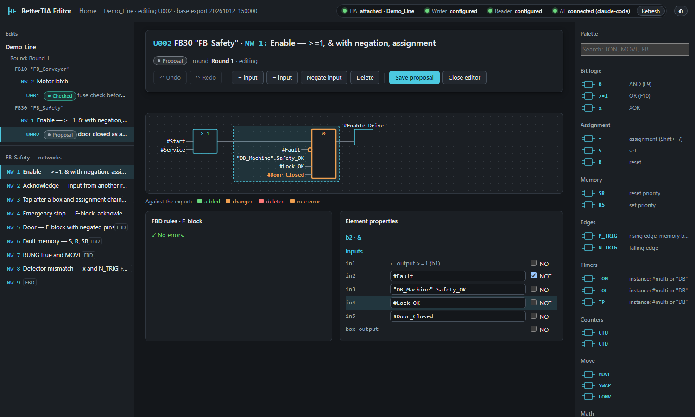
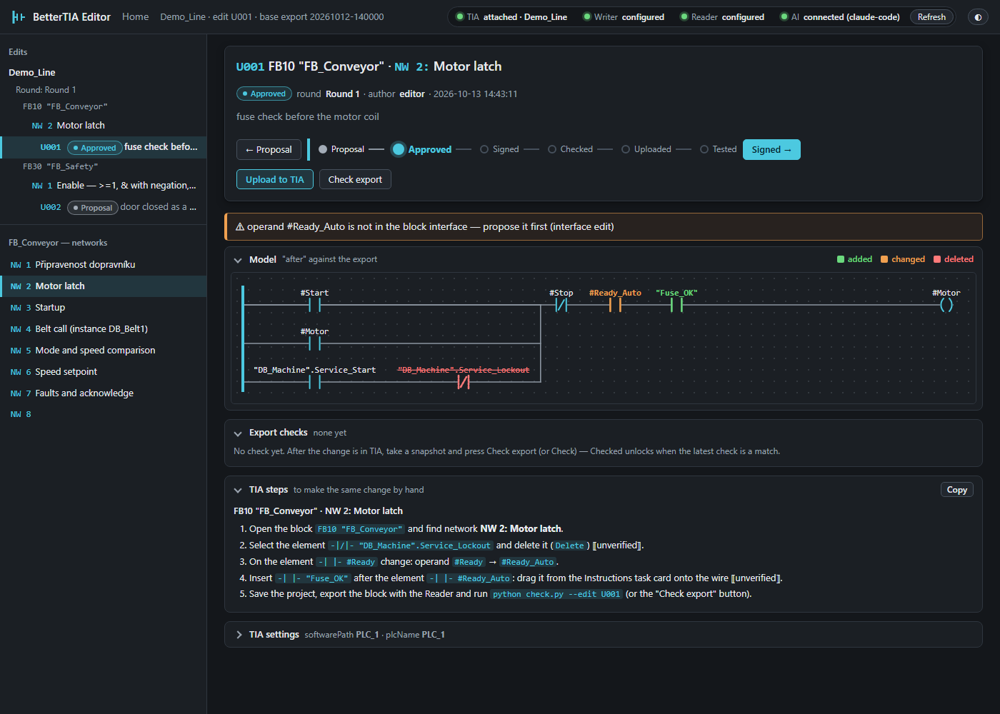
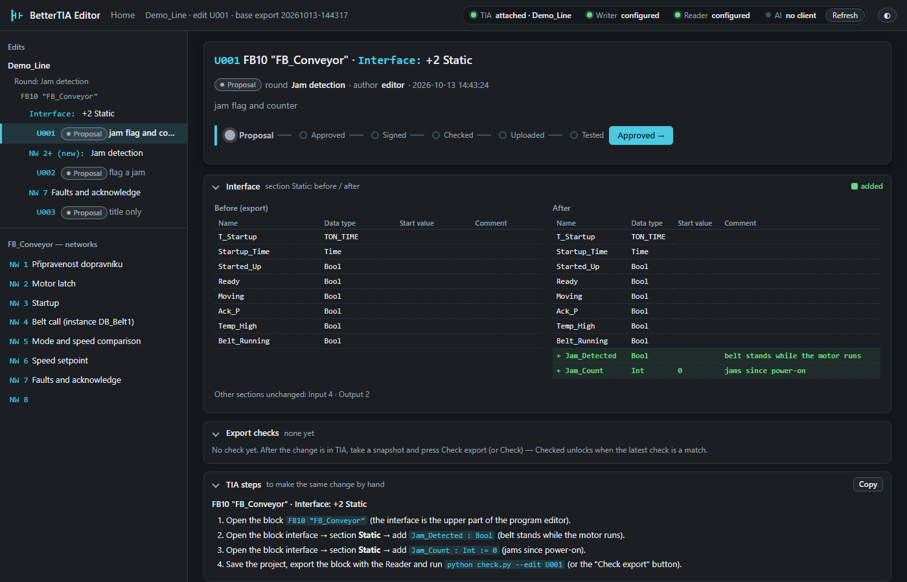
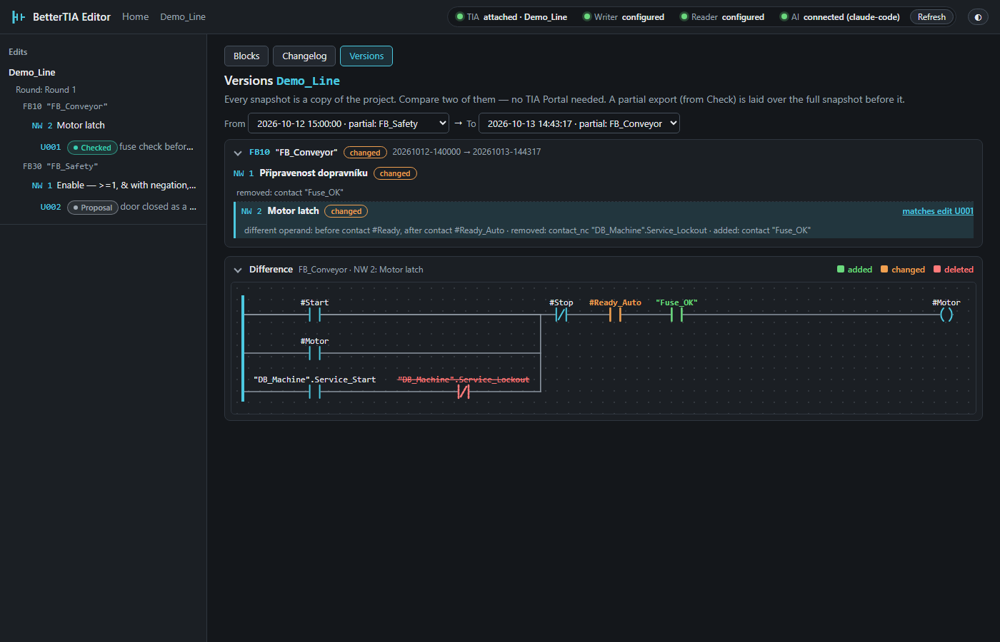

# BetterTIA Editor

**A review tool for AI-proposed changes to TIA Portal networks.** An AI agent proposes a change to one LAD or FBD
network; you see the before/after diff drawn the way TIA Portal draws it, approve it, and track it until it is in the
project and tested. A local web app built on the text export (`.s7dcl` / `.s7res`, SIMATIC source documents,
TIA Portal V20+).


## Why

AI agents can already read a PLC program and suggest a fix, but nobody should paste an unreviewed change into a
machine. This editor puts a person between the agent and TIA Portal: every change is one network, shown as a diagram
diff, with step-by-step instructions to make it by hand. Approving, writing to the project and testing stay explicit
steps a person takes, and each step is recorded.

## Workflow



| | |
|---|---|
|  |  |
| Home: projects, connection strip (TIA, Writer, Reader, AI), connecting an agent | A change after Upload and Check: stepper, diff, export checks, Writer/Reader steps |
|  |  |
| FBD editor: palette, insertion points, rule check, element properties | TIA steps: the same change as instructions for TIA Portal |

It is the third tool of the BetterTIA set:

| Tool | Role |
|---|---|
| [reader](https://github.com/BetterTIA/reader) | reads a TIA Portal project through Openness and exports it to a folder (read-only MCP server) |
| [writer](https://github.com/BetterTIA/writer) | writes to a TIA Portal project through Openness (MCP server) |
| **editor** (this repository) | draws a network from the export, lets you compose a change and tracks it until it is in the project |

> Status: early and experimental. Everything here is tested against the bundled sample project only;
> writing a network back to a live TIA Portal has not been verified yet.

## What it does

- Renders a network from a Reader export the way TIA Portal draws it (LAD and FBD), as SVG.
- Editor with a palette of instructions and of the project's own blocks, insertion points, branches,
  undo/redo and validation of LAD/FBD rules.
- A tree of changes per network with six states:
  `Proposal → Approved → Signed → Checked → Uploaded → Tested`.
- Shows the difference between the network before and after a change and generates step-by-step
  instructions for making the same change by hand in TIA Portal.
- "Export = proposal" check: compares a fresh export with the approved change.
- Optional `Upload` (through the writer) and `Check` (through the reader) for non-safety blocks. Networks of
  fail-safe blocks are never uploaded; they are changed by hand.
- A changelog of the project and a comparison of two snapshots (versions), see below.
- An MCP server (`mcp_server.py`), so an AI agent can read projects and networks, propose a change, check an export
  and take a screenshot — on top of a small HTTP API.

## What an edit can be

- **Network change** — the "after" model of one LAD or FBD network, drawn as a diff against the export.
- **Title and comment** — a new network title / comment, alone or together with a network change.
- **New network** — inserted after network *n* (or at the start) with its title, language and content.
- **Interface** — new members in one section of the block interface (Input, Output, InOut, Static, Temp, Constant);
  a network edit that uses a `#operand` the interface lacks gets a warning pointing at the interface edit.
- **Group** — several edits that make one change (e.g. two statics, a new network, a renamed network): one state,
  TIA steps of all members in order, Upload in order (interface → new networks → changes), one check.

Fail-safe blocks get every kind of edit as a proposal with TIA steps; Upload stays refused for them.



## Changelog and versions

The editor keeps a copy of the project: every snapshot is a Reader export with a timestamp. The project page has two
more tabs. **Changelog** lists what changed and when — who proposed an edit, who approved it, what the writer wrote,
what the reader checked, and every snapshot — per day, filtered by state or block, and copies it as Markdown with
block, number and network title on every row. **Versions** compares two snapshots without TIA Portal: the changed
blocks, in each the networks added, removed, changed or moved, and the difference drawn as for an edit. A network that
is the "after" of an edit links to it (*matches edit U001*).



## Requirements

- Python 3 (standard library only, no packages to install)
- A Chromium-based browser; headless Chrome or Edge is used for screenshots and for the click tests

## Run

```
python server.py --port 8765 --export-root tests\samples --data data
```

Then open `http://localhost:8765/`. The server listens on `127.0.0.1` only and answers only requests addressed to
`localhost` or `127.0.0.1` with its port.

- `--export-root` is a folder laid out as `<project>\<timestamp>\<PLC>\Blocks\…\<block>.s7dcl`, which is
  what the reader's `export_to_folder` produces. `tests\samples` holds a made-up sample project.
- `--data` is where the changes are stored (`<data>\<project>\state.json`).
- `--mcp-json`, `--writer-cmd`, `--reader-cmd` configure the writer and the reader (TIA status, snapshots, Upload, Check).
- `--no-autoconnect` stops the automatic TIA check at start and on the home page.
- With the fake Writer/Reader (`tests\fake_mcp.py`) or `--demo` the editor is a **demo instance**: a striped banner on
  every page, `attached (fake)` in the status bar, and projects outside `--export-root` are refused. Start the editor
  for a real project without the fake commands.

## How it connects to TIA

The home page (`/`) lists the projects and lets you add one from an export folder on disk, from the project open in
TIA Portal, or from an `.ap21` file. The status bar on every page shows TIA (`not running` / `running: <project>` /
`attached`), the writer, the reader and the AI client. At start (and when the home page opens) the editor asks the
writer for the running TIA Portal instances (`GetPortals`); with exactly one it attaches to it (`Connect` with its
`portalId`) and reads the open project. It never starts TIA Portal for that check; only *Open .ap21 file* may start it.

*New snapshot* exports the whole PLC through the reader (`export_to_folder`, in chunks) as a background job and
registers it as the project's newest export, which the networks are drawn from.

> The reader writes exports into **its own** export root (its `--export-root` option), not into a folder chosen per
> call. Run the editor with the same export root, or add the reader's folder as a project; the editor reports a
> mismatch instead of guessing.

## Connect an AI agent

Start the editor, then let your MCP client start `mcp_server.py` (it talks to the running editor over HTTP):

```json
{ "mcpServers": { "bettertia-editor": { "command": "python", "args": ["mcp_server.py", "--server", "http://localhost:8765"] } } }
```

That is `.mcp.json` for Claude Code or `.cursor/mcp.json` for Cursor; any other client runs
`python mcp_server.py --server http://localhost:8765` as a stdio server. Use the full path of `mcp_server.py` when the
client does not start in this folder. The home page shows the same blocks to copy, and the status bar shows
**AI: connected (&lt;client&gt;)** once the agent is attached.

Tools: `list_projects`, `list_blocks`, `get_network`, `list_edits`, `get_edit`, `propose_edit`, `update_edit`,
`create_group`, `get_group`, `run_check`, `get_procedure`, `tia_status`, `take_snapshot`, `get_job`, `get_changelog`, `list_snapshots`,
`compare_snapshots`, `screenshot` — see
[docs/reference.md](docs/reference.md#mcp-server).

**Why the agent cannot approve or upload:** a change of a PLC program ends up on a real machine. The agent proposes
and checks; moving a change through `Approved → Signed → …`, Upload and Check stay buttons a person clicks after
reviewing the diff.

## Tests

```
python -m unittest discover -s tests
```

The screenshots in `tests\screenshots\` and `docs\demo.gif` are regenerated from the sample project with the fake
Writer/Reader by `python tools\screenshots.py` (needs Chrome or Edge and a free port 8765).

## Documentation

The full reference (API, data model, editor operations, grammar notes) is in [docs/reference.md](docs/reference.md).

Two small command-line helpers talk to a running server:

```
python check.py --server http://localhost:8765 --edit <id> [--export-ts <ts>] | --check <id> | --procedure <id>
python screenshot.py --url <url> --out <png> [--width <px> --height <px>]
```

`check.py --edit` compares a fresh export with the change (exit 0 match, 1 mismatch, 2 error), `--check` runs the
Reader-based Check, `--procedure` prints the step-by-step instructions for TIA Portal. `screenshot.py` saves a page
as PNG with headless Chrome or Edge.

## Safety

This tool can change a PLC program. Work on a copy or an archived project, review every change before it is
downloaded, and treat fail-safe (F) blocks as manual work with their own approval.

## License

MIT, see [LICENSE](LICENSE).

TIA Portal, SIMATIC and WinCC are trademarks of Siemens AG. This project is not affiliated with or endorsed
by Siemens.
