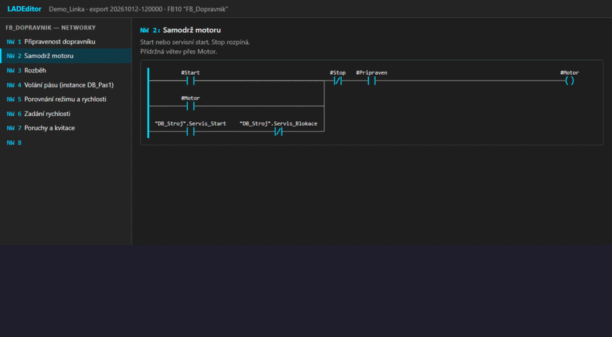

# BetterTIA Editor

A local web app for viewing and editing single LAD and FBD networks of a TIA Portal project, built on top of
the text export (`.s7dcl` / `.s7res`, SIMATIC source documents, TIA Portal V20+).



It is the third tool of the BetterTIA set:

| Tool | Role |
|---|---|
| [reader](https://github.com/BetterTIA/reader) | reads a TIA Portal project through Openness and exports it to a folder (read-only MCP server) |
| [writer](https://github.com/BetterTIA/writer) | writes to a TIA Portal project through Openness (MCP server) |
| **editor** (this repository) | draws a network from the export, lets you compose a change and tracks it until it is in the project |

> Status: early and experimental. Everything here is tested against the bundled sample project only;
> writing a network back to a live TIA Portal has not been verified yet.

## What it does

- Renders a network from a Reader export the way TIA Portal draws it (LAD and FBD), as SVG.
- Editor with a palette of instructions and of the project's own blocks, insertion points, branches,
  undo/redo and validation of LAD/FBD rules.
- A tree of changes per network with six states:
  `Proposal → Approved → Signed → Checked → Uploaded → Tested`.
- Shows the difference between the network before and after a change and generates step-by-step
  instructions for making the same change by hand in TIA Portal.
- "Export = proposal" check: compares a fresh export with the approved change.
- Optional `Upload` (through the writer) and `Check` (through the reader) for non-safety blocks. Networks of
  fail-safe blocks are never uploaded; they are changed by hand.
- A small HTTP API, so an AI assistant can read the state, propose a change and take a screenshot.

## Requirements

- Python 3 (standard library only, no packages to install)
- A Chromium-based browser; headless Chrome or Edge is used for screenshots and for the click tests

## Run

```
python server.py --port 8765 --export-root tests\samples --data data
```

Then open `http://localhost:8765/`. The server listens on `127.0.0.1` only.

- `--export-root` is a folder laid out as `<project>\<timestamp>\<PLC>\Blocks\…\<block>.s7dcl`, which is
  what the reader's `export_to_folder` produces. `tests\samples` holds a made-up sample project.
- `--data` is where the changes are stored (`<data>\<project>\state.json`).
- `--mcp-json`, `--writer-cmd`, `--reader-cmd` configure the writer and the reader (TIA status, snapshots, Upload, Check).
- `--no-autoconnect` stops the automatic TIA check at start and on the home page.

## How it connects to TIA

The home page (`/`) lists the projects and lets you add one from an export folder on disk, from the project open in
TIA Portal, or from an `.ap21` file. The status bar on every page shows TIA (`not running` / `running: <project>` /
`attached`), the writer, the reader and the AI client. At start (and when the home page opens) the editor asks the
writer for the running TIA Portal instances (`GetPortals`); with exactly one it attaches to it (`Connect` with its
`portalId`) and reads the open project. It never starts TIA Portal for that check; only *Open .ap21 file* may start it.

*New snapshot* exports the whole PLC through the reader (`export_to_folder`, in chunks) as a background job and
registers it as the project's newest export, which the networks are drawn from.

> The reader writes exports into **its own** export root (its `--export-root` option), not into a folder chosen per
> call. Run the editor with the same export root, or add the reader's folder as a project; the editor reports a
> mismatch instead of guessing.


## Tests

```
python -m unittest discover -s tests
```

## Documentation

The full reference (API, data model, editor operations, grammar notes) is in [docs/reference.md](docs/reference.md).

Two small command-line helpers talk to a running server:

```
python check.py --server http://localhost:8765 --edit <id> [--export-ts <ts>] | --check <id> | --procedure <id>
python screenshot.py --url <url> --out <png> [--width <px> --height <px>]
```

`check.py --edit` compares a fresh export with the change (exit 0 match, 1 mismatch, 2 error), `--check` runs the
Reader-based Check, `--procedure` prints the step-by-step instructions for TIA Portal. `screenshot.py` saves a page
as PNG with headless Chrome or Edge.

## Safety

This tool can change a PLC program. Work on a copy or an archived project, review every change before it is
downloaded, and treat fail-safe (F) blocks as manual work with their own approval.

## License

MIT, see [LICENSE](LICENSE).

TIA Portal, SIMATIC and WinCC are trademarks of Siemens AG. This project is not affiliated with or endorsed
by Siemens.
