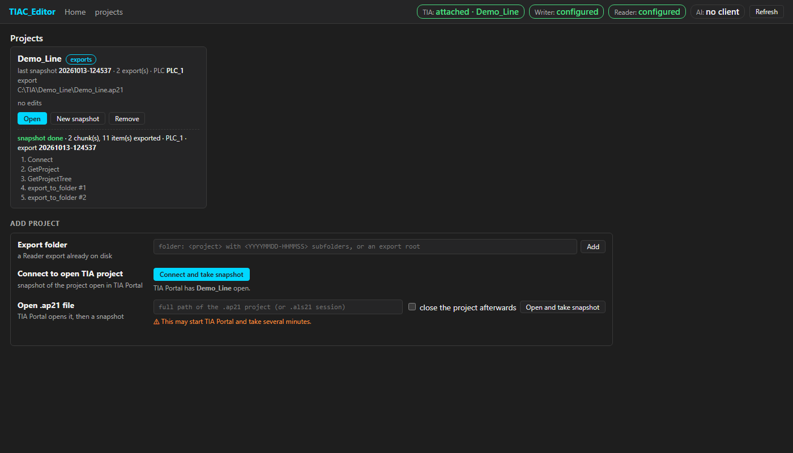

# BetterTIA Editor — reference

A local viewer and editor for LAD and FBD networks (view, edit, export check, TIA steps), built on the Reader
export (`.s7dcl` + `.s7res`). Nothing to install: Python 3 standard library, vanilla JS + SVG, headless Chrome
for screenshots.

## Run
```
python server.py --port 8765 --export-root "C:\TIA\export" --data "data\editor"
```
- `--export-root` = the **default** export root, a folder laid out as
  `<project>\<timestamp YYYYMMDD-HHMMSS>\<PLC>\Blocks\…\<block>.s7dcl`. A block is looked up by file name in the
  **newest** export that contains it (partial exports are fine). Projects found here are added to the project
  registry at start; other projects can have their own export root (see [Home, projects and TIA](#home-projects-and-tia)).
- `--data` (required) = folder with the change data, `<data>\<project>\state.json` (see [Changes and states](#changes-and-states))
  and the project registry `<data>\projects.json`.
- On the bundled samples: `--export-root tests\samples`.
- `--mcp-json`, `--writer-cmd`, `--reader-cmd`, `--mcp-timeout` configure the Writer and the Reader (TIA status,
  snapshots, Upload and Check; see [Upload and Check](#upload-and-check)).
- `--no-autoconnect` = do not check TIA Portal at start and when the home page opens (only the Refresh button does).
- The server listens on `127.0.0.1` only; POST/PUT/DELETE with an `Origin` other than `localhost`/`127.0.0.1` get 403.

## Page
`http://localhost:8765/?project=<project>&block=<block>&nw=<n>[&screenshot=1][&theme=light|dark]`
- without parameters = the home page (projects, Add project, see [Home, projects and TIA](#home-projects-and-tia)),
- `?project=<project>` without `block` = block picker over that project's exports,
- every page has the status bar (TIA, Writer, Reader, AI, Refresh) and a Home link in the header,
- left: the block's networks (number + title, language when not LAD); right: the network drawn as in TIA Portal,
- `?edit=<id>` opens a change, `?edit=<id>&edit_mode=1` opens it in the editor; `screenshot=1` marks the page for
  a screenshot; `theme` forces the theme (otherwise the system theme, default dark); `lad=1` shows an FBD network
  as LAD (see [Show as LAD](#show-as-lad)).

## Home, projects and TIA
The editor sits between an AI assistant and TIA Portal: with TIA Portal open, it attaches to the open project by
itself, shows the connection state and keeps a copy of the project (a **snapshot** = a Reader export) that edits are
drawn from. Without TIA Portal it is a viewer of exports already on disk.



**Home page** (`/`): one card per project (name, source, last snapshot, number of exports, PLC, edits by state,
Open / New snapshot / Remove, the progress of the last snapshot job) and **Add project**:
- *Export folder* — a folder on disk: a project folder (`<project>\<YYYYMMDD-HHMMSS>\…`) or an export root with
  project folders (each one is added);
- *Connect to open TIA project* — snapshot of the project open in TIA Portal (does not start TIA);
- *Open .ap21 file* — the Writer's `OpenTiaProject` opens the project (it **may start TIA Portal and take minutes**),
  then a snapshot; optionally the project is closed afterwards (`CloseProject`, without saving).

Without projects the page shows a short hint. Screenshots: `tests\screenshots\home_empty.png`, `home_projects.png`,
`home_tia_attached.png`, `snapshot_progress.png`.

**Project registry** `<data>\projects.json`:
`[{name, source: "exports"|"tia"|"ap21", export_root, project_path?, tia: {softwarePath, plcName}?, last_snapshot?, added}]`.
The project name is the key (it is also the folder name under the export root and in `<data>`). Projects in the
default `--export-root` are added at start with `source: "exports"`; a removed one comes back at the next start if it
is still there. `tia` from the registry is used by Upload/Check when `state.json` has no `tia` (state.json is not changed).

| Method | Path | Body → answer |
|---|---|---|
| GET | `/api/projects` | `{projects: [registry entry + {exports, latest_export, edits: {state: count}, job}], default_export_root, running_job}` |
| POST | `/api/projects` | `{source: "exports", path}` → 201 `{projects: [entry]}`; `{source: "tia", portalId?, softwarePath?}` or `{source: "ap21", path, close?, softwarePath?}` → 202 `{job}` |
| DELETE | `/api/projects/<name>` | removes the entry only (exports and edits stay on disk) |
| POST | `/api/projects/<name>/snapshot` | `{portalId?, softwarePath?, close?}` → 202 `{job}` |
| GET | `/api/jobs`, `/api/jobs/<id>` | jobs of this server run: `{id, kind, project, state: running|done|error, steps: [{step, ok, message}], chunks, exported, plc, plc_choices?, portal_choices?, error, result: {project, export_ts, export_folder}}` |
| GET | `/api/tia/status[?refresh=1][&portalId=]` | cached status; `refresh=1` checks again, `portalId` chooses an instance |

**TIA status** (`GET /api/tia/status`): `{tia: "unknown"|"not running"|"running"|"attached"|"choose", project,
project_path, portalId, instances: [{portalId, project, path, attached}], writer, reader: "configured"|"missing"|"error: …",
reader_export_root, ai: "no client", checked, autoconnect, chosen, time, busy?}`.
1. Writer `GetPortals {}` — no instance → `not running`, **no `Connect`** (without `portalId` it would start TIA);
2. one instance (or the one chosen with `portalId`) → `Connect {portalId}` + `GetProject {portalId}` → `attached`;
3. more instances → `choose` (the status bar shows a picker);
4. when attached, Reader `get_project_status {}` checks the Reader.

Every tool call of the check has a 30 s timeout; a Writer that cannot start or fails gives `writer: "error: …"`, never
a crash. The check runs once in the background at start and when the home page opens, unless `--no-autoconnect`;
while a job holds TIA the cached status is returned with `busy: true`. `ai` is a placeholder for the editor's own MCP server.

**Snapshot** (a background job; one job at a time, the same lock as Upload/Check → 409 when busy):
1. Writer: `OpenTiaProject {path, portalId?}` for an `.ap21` project, otherwise `Connect {portalId}` (the attached
   instance from the status, or the only one from `GetPortals`; not running / several instances = an error);
2. `GetProject` (project name and path), PLC software from `OpenTiaProject` / `GetProjectTree` / `GetDevices`
   (the first dict entries with `softwarePath`; one PLC is taken, more = the job ends with `plc_choices` and the UI
   offers a button per PLC; `softwarePath` in the body chooses);
3. Reader: `export_to_folder {include: [blocks, types, tagTables], formats: [documents], plcName, timeBudgetSeconds: 120,
   projectPath?}` for the **whole PLC**, repeated with `runId` + `offset` = `nextOffset` while `complete` is false;
4. the export folder is taken from the answer (a path with a `<project>\<YYYYMMDD-HHMMSS>` part), the project is
   registered or updated (`export_root`, `last_snapshot`, `tia`); `.ap21` + `close` → `CloseProject`.

⚠ **The Reader exports into its own export root** — the `--export-root` in its command (or `TIA_MCP_EXPORT_ROOT`),
not into a folder given per call — and names the project folder after the TIA project. A new project from TIA is
therefore registered with the Reader's export root. A *New snapshot* of a project whose export root (or name) differs
from where the Reader writes ends with an error that names both folders: point the editor's `--export-root` (or the
project) to the Reader's export root. The status bar shows the Reader's export root in the Reader tooltip.

## API — browsing the export
| GET | Returns |
|---|---|
| `/api/exports` | `{export_root, projects: [{project, exports: [{ts, block_count}], blocks: [{block, ts}]}]}` — exports with their block count, blocks with their newest `ts` |
| `/api/block?project=&block=[&ts=]` | `{project, ts, block, file, kind, number, language, title, networks: [{nw, language, title}]}` |
| `/api/network?project=&block=&nw=[&ts=][&width=px]` | network model: `elements`, `rungs`, `wires`, `layout {id: {r, c}}`, `drawing` (SVG geometry), `warnings`, plus `kind`, `number`, `title`, `comment`, `f` (F-block) |

Element (`elements[]`): `{id, type, …}` — `type` ∈ `contact`, `contact_nc`, `contact_p` / `contact_n` (+ `bit`),
`comparison` (`op`, `in1`, `in2`, `template`), `coil`, `coil_s` / `coil_r` / `coil_neg` / `coil_p` / `coil_n`,
`ret`, `not`, `box` (`call` fb | fc | instruction, `name`, `instance`, `template`, `power` [EN, ENO] / [IN, Q] …,
`inputs` / `outputs` `[{pin, operand}]`, P_TRIG `below`). A pin with operand `wire#wN` is fed from another rung.
`rungs` = the raw shape from `.s7dcl` (`{from, path, to}`), `wires` = graph edges (`{from, to}`, `to: null` = open end).

`width` = canvas width in px; coils are aligned to its right edge (the page sends the window width).

Networks in other languages (SCL, STL) or that cannot be laid out come with a warning and `text` (the network source).

## Changes and states
**Storage:** `<--data>\<project>\state.json` (e.g. `data\editor\Demo_Line\state.json`). **Only the server** writes
it (lock + temporary file + `os.replace`); while the server runs, do not edit the file by hand — use `PUT /api/state`.

Change (edit): `{id (U001…, unique across projects), project, round, block, kind, block_number, nw, title, language, f,
author, time, state, note, history: [{state, time, by}], before: {elements, rungs, wires, layout, export_ts},
after: {…}, checks: [{time, match, export_ts, note}], writes: […]}`. Block number, network title, `f` and `before`
are filled in by the server from the current export — never entered by hand (whatever the client sends is ignored).

States: `Proposal → Approved → Signed → Checked → Uploaded → Tested`.
- **Signed** = written to the TIA project (by hand, or by **Upload**); free transition.
- **Checked** = the export after writing matches the proposal; allowed only when the **last** check is a match
  (a later mismatch locks it again), otherwise **409**. `checked_allowed` in `GET /api/edits/<id>`.
- **Uploaded** / **Tested** are set by the user.
- Only one step forward or back at a time.

| Method | Path | Purpose |
|---|---|---|
| GET | `/api/state[?project=]` | the whole `state.json` of a project; without a project `{projects: [{project, edits}]}` |
| PUT | `/api/state?project=` | replaces the whole file (structure, ids and states are validated) |
| POST | `/api/edits` | new change `{project, round, block, nw, after, note}` → 201, state Proposal, author `editor` |
| GET | `/api/edits/<id>[?width=]` | change + drawing of "after" with `diff` marks (`added` / `changed`, ghosts `x:<id>` = `deleted`), `next`, `previous`, `checked_allowed`, `errors`, `tia`, `warnings` |
| POST | `/api/edits/<id>/state` | `{state, by}` — one step forward/back; Checked only after a matching check, otherwise 409 with the reason |
| PUT/POST | `/api/edits/<id>/after` | saves the "after" model (Proposal only; rule errors do not block saving) → `{edit, errors}` |
| POST | `/api/check` | `{edit_id, match, export_ts, note}` — records the result of comparing an export with the proposal by hand (automatic: see [Export check](#export-check)) |

The `after` model has the same shape as `/api/network` (`elements` + `rungs`; the server computes `wires` and
`layout`). **Elements are paired by `id`**: keep a kept element's original id, give a new one a new id (e.g. `n1`),
drop a deleted one from both `elements` and `rungs`. Changed operand/pins = orange, new element = green, deleted =
red dashed ghost at its original place (if there is no place for it in "after", it is listed as a warning).

```
# proposal (JSON in a file, so the shell does not fight with quotes)
curl -s -X POST -H "Content-Type: application/json" --data-binary @proposal.json http://localhost:8765/api/edits
#   proposal.json: {"project":"Demo_Line","round":"Round 1","block":"FB_Conveyor","nw":2,"note":"…","after":{"elements":[…],"rungs":[…]}}
#   start "after" from GET /api/network (copy elements + rungs and change them)
# export check recorded by hand
curl -s -X POST -H "Content-Type: application/json" -d '{"edit_id":"U001","match":true,"export_ts":"20261012-130000","note":"export = proposal"}' http://localhost:8765/api/check
# state change (the UI calls the same)
curl -s -X POST -H "Content-Type: application/json" -d '{"state":"Approved","by":"reviewer"}' http://localhost:8765/api/edits/U001/state
```
Page `?edit=U001`: on the left a tree `project → round → block → NW → change (state in colour)` above the block's
network list; on the right the change header, "← previous / next →" buttons (Checked greyed out with a tooltip until
there is a matching check), the checks, a legend and the canvas with the difference. Round names are merged in the
tree regardless of letter case and surrounding spaces. If a change is already Checked or later and its last check is
a mismatch, a warning is shown (the state does not go back by itself).

## Editor, catalog, LAD rules
**Editor:** a change in state Proposal has an Edit button (`?edit=<id>&edit_mode=1`); from the network view,
"Propose a change" creates a Proposal with `after = before` in the given round and opens the editor. On the right is
the **palette** (instructions + project blocks, search). Clicking a palette item highlights the **valid insertion
points** (circles on the wires before elements and after the last element of a section) → click a point, or
**drag** the item onto a wire (snaps to the nearest valid point within 45 px). **Branch**: button → click the start
and the end of a section in one rung; the element is the one selected in the palette, otherwise a NO contact; an end
after the last element of an open rung = output branch. Clicking an element = selection + properties panel (operand /
pin table, instance, type) with autocomplete; **Delete** deletes, **Ctrl+Z / Ctrl+Y** (also Ctrl+Shift+Z),
**Esc** cancels insertion/branch/selection. After each change the server recomputes the model (layout + diff against
"before" + errors). "Save proposal" = `POST /api/edits/<id>/after` (also with errors; the change header then shows
"⚠ N LAD errors").

**LAD rules** (`model.validate`, below the canvas + orange frame on the element): a box (FB/FC/instruction) inside a
closed parallel branch; a coil/RET anywhere but at the end of a rung; missing operand, edge memory bit, instance or
instruction input (PT, IN…; FB inputs are optional); a comparison without both operands; an unpowered rung (starts in
a node nothing leads into); a parallel section whose main path is only a wire (e.g. after deleting a contact) →
"Branch without an element in the main path"; a circuit that cannot be laid out.

**Catalog** `GET /api/catalog?project=` → `{project, instruction: [{key, name, group, description, element}],
blocks: [{key 'fb:X'|'fc:X', name, kind, number, interface, instance: ['"DB"'], f, element}], fbd: [FBD palette],
db: [{name, number, instance_type, members}], tags: [{name, type, address, table}]}`. `element` = a template in the
model shape (without `id`). Instruction keys: `NO NC P N C S R NEG RET EQ NE GT GE LT LE TON TOF TP CTU CTD MOVE SWAP
CONV ADD SUB MUL DIV IN_RANGE P_TRIG N_TRIG`. Source: the newest `.s7dcl` of each block (interface
`VAR_INPUT/VAR_OUTPUT/VAR_IN_OUT`, IN_OUT as inputs), `DATA_BLOCK "X" : "FB"` = instance, tag tables
`<PLC>\Tags\**\*.xml` (SimaticML `SW.Tags.PlcTag`).

**Operations and layout trial (for scripts and AI assistants; nothing is saved):** `POST /api/layout`
`{project, after, before?, ops?, width?}` → `{after, drawing, layout, diff, places, errors, warnings, last}`.
Operations (`ops` are applied in order):

| op | shape |
|---|---|
| insert in series | `{"type":"insert","place":{"r":0,"k":2},"element":"TON"}` — `r` = rung index, `k` = position in `path` (before item k; `k = len` = end) |
| branch | `{"type":"branch","from":{"r":0,"k":1},"to":{"r":0,"k":2},"element":"fb:FB_Belt"}` |
| delete | `{"type":"delete","id":"p3"}` (for a box also the rungs feeding its pins) |
| change | `{"type":"change","id":"n1","values":{"operand":"\"Ack\""}}` — fields `operand bit in1 in2 op template instance below inputs outputs` |

`element` is a palette key or a whole element (dict). New elements get `n1, n2…`, new nodes `wire#wN` (the diff pairs
by id). Typical flow: `GET /api/network` → `POST /api/layout` with `after = {elements, rungs}` and `ops` → check
`errors` → `POST /api/edits` (new) or `POST /api/edits/<id>/after` (Proposal) with the returned `after`.

**Scenario in the URL** (screenshots; headless has no mouse):
`?edit=<id>&edit_mode=1&ops=<URL-encoded JSON list of operations>&select=<id>&palette=<key>&branch=<r>,<k>` — the
operations run as in the UI (not saved). For FBD also `&input=<n>` (selected input).

## Export check
After a change is written to the project (by hand or by the Writer) and exported by the Reader into the server's
export root:
```
python check.py --server http://localhost:8765 --edit U003 [--export-ts 20261012-140000]
```
Exit **0 = match, 1 = mismatch, 2 = error** (server not running, change / export / block not found). Prints one line
`MATCH|MISMATCH <id> · export <ts> · NW <n> · <note>`. The result is always recorded on the change as a check (same
as `POST /api/check`), so the last matching check unlocks Checked.

**From the UI:** a change in state Approved or later has a "check with export" button (uses the newest export); the
result appears under the export checks, a mismatch also at the top as a warning.

**Server:** `POST /api/edits/<id>/check-export` `{export_ts?}` → `{match, export_ts, nw_export, note, diffs, edit}`.
Steps: the newest (or given) export that contains the block → the network by **title** (a moved number is recorded in
the note, e.g. "the network moved: NW 1 → NW 2"), without a title by number → comparison with the "after" model
**by content** (`diff.content_match`): elements without `id`, `call`, `power` and empty values (empty pins are
ignored, `wire#wN` = `wire#`), as a multiset → readable "missing in the export / extra in the export / different
operand / different pins"; when the elements match, the topology is compared (series / branch tree from
`layout.tree`, branch order does not matter) → "the wiring differs". When the export is the same as "before", the
note says so.

Instance DBs and FC calls are resolved from the newest copy of each block up to the given export (also when the
export is partial); `"FC"(…)` is `call: fc` with the FC name.

## FBD — model and viewing
**Model** (`fbd.py`, its own model, not a conversion to LAD): `{language: "FBD", elements: [box], signals: [{from, to, input}]}`.
- box = `{id, type, inputs: [{n, pin, operand, signal, neg}], outputs: [{pin, operand, neg}], operand?, name?,
  instance?, template?, attributes?, neg_output?}`; `type` ∈ `and or xor assign s r sr rs ptrig ntrig call instruction`.
- The 1st input is the chain input (`in1`, `CLK`, `S`/`R`, `EN` for calls/instructions; an F-block call without
  power flow has no EN). `signal` = id of the box whose main output feeds the input (the operand is then `''`);
  `neg` = negation circle.
- `operand` = the operand above the box (`=`, S, R, SR/RS, edge memory bit); `call`: `name` (FB type / F-instruction),
  `instance`, `attributes` (`f_user_card`…).
- Ids from the export are `b1, b2…` (order in the text), new elements `n1…`. `signals` are derived — the server
  computes them from the inputs, sending `elements` is enough.

**FBD grammar in `.s7dcl`** (V21): `RUNG <operand>|wire#wN|true` + elements in sequence (the output of the previous one
= the 1st input of the next): `A(in2 := …, in3 := …)` &, `O(…)` >=1, `X(…)` x (not verified against an export),
`Coil(x)` =, `S_Coil`/`R_Coil`, `S_SR(r1 := …, operand := …)` (not verified), `P_Trig(mem)`/`N_Trig`, `Move(…)`,
calls `#inst.TYPE(…)` / `"Inst"(…)` with attributes `{ f_user_card := "1"; … }`. `NOT` before an element = negated
1st input, `pin := NOT x` = negated input. `wire#wN` inside a rung = a tap after the box, `END_RUNG wire#wN` = the
rung's output; `in2 := wire#wN` / `RUNG wire#wN` = fed from them. Several `Coil`s in a row = a chain of assignments.
`RUNG` + `END_RUNG` = empty network.

**Layout** (`fbd.layout`): a tree by the main consumer (the first in export order); sources on the left, assignments
on the right, a box's output on the line of its 1st input (a chain = a straight line), a box feeding another input
is placed on that input's line; further consumers of the same output = a tap (vertical in the column's channel,
node). Box = rectangle with a title (`&`, `>=1`, `x`, `=`, `S`, `R`, `SR`, `P_TRIG`, FB name), operand / instance
above the box, pins shown only for SR/edges/calls/instructions. A cycle or a signal from a non-existent box →
`LayoutError` → the page shows the network text with a warning.

**API for FBD:**
| Method | Path | FBD |
|---|---|---|
| GET | `/api/network?…` | `language: "FBD"`, `elements`, `signals`, `layout {id: {r, c}}`, `drawing {fbd: true, boxes, lines, nodes}`, `as_lad?` |
| POST | `/api/layout` | `{project, after: {language: "FBD", elements}, before?, ops?, f?}` → `after`, `drawing`, `diff`, `pin_diff`, `places`, `errors` (nothing saved) |
| POST | `/api/edits` | `{project, round, block, nw, after: {elements}, note}` — for an FBD network `after` is the FBD model; number, title, `before` are filled in by the server |
| PUT/POST | `/api/edits/<id>/after` | saves the FBD "after" (Proposal only; the language of a proposal cannot change → 400) |
| GET | `/api/edits/<id>` | `language: "FBD"`, drawing with diff, `pin_diff {id: {inputs: [n], outputs: [pin], above}}`, `errors` (FBD rules) |

Diff: a new box green, a changed one orange — **in a changed box only the changed inputs / outputs / operand are
orange** (`pin_diff`), a deleted box red dashed as a separate ghost (hanging on the signal that fed it).

```
# 1) network -> 2) trial of operations -> 3) proposal (JSON in files, so the shell does not fight with quotes)
curl -s "http://localhost:8765/api/network?project=Demo_Line&block=FB_Safety&nw=1" > net.json
#   layout.json: {"project":"Demo_Line","before":{"language":"FBD","elements":<net.elements>},"after":{"language":"FBD","elements":<net.elements>},
#                 "ops":[{"type":"add_input","id":"b2","operand":"#X"},{"type":"change_operand","id":"b3","operand":"#Y"}]}
curl -s -X POST -H "Content-Type: application/json" --data-binary @layout.json http://localhost:8765/api/layout > layout_out.json
#   proposal.json: {"project":"Demo_Line","round":"FBD demo","block":"FB_Safety","nw":1,"note":"…","after":<layout_out.after>}
curl -s -X POST -H "Content-Type: application/json" --data-binary @proposal.json http://localhost:8765/api/edits
```

## FBD — editor, rules, export check
**FBD operations** (`fbd.apply`, `ops` in `POST /api/layout` — used by both scripts and the editor; new boxes `n1…`):
| op | shape |
|---|---|
| insert box | `{"type":"insert_box","element":"AND","to":{"id":"b2","input":1}}` — the box takes over the input's signal/operand on its 1st input and feeds the input with its output; `input` = count+1 on &/>=1/x = a new input; without `to` = a new logic path. FBD palette keys: `AND OR XOR ASSIGN S R SR RS P_TRIG N_TRIG`, from the catalog `MOVE`, `ADD`… and `fb:X` / `fc:X` |
| insert call | `{"type":"insert_call","element":"fb:FB_Belt","instance":"\"DB_Belt1\"","to":…}` — in an F-block (`f: true` in the body) without EN |
| inputs | `{"type":"add_input","id":"b2","operand":"#X"}` · `{"type":"remove_input","id":"b2","input":3}` (only &/>=1/x with more than 2 inputs) |
| negation | `{"type":"negate","id":"b2","input":2}` · `"output":"Q"` (call pin) · `"output":"main"` (the box's main output → `neg_output`) |
| operands | `{"type":"change_operand","id":"b3","operand":"#Y"}` (above the box / instance) or with `"input": n` / `"output": "PIN"` (the input's signal is replaced by the operand) · `{"type":"change_pin","id":"b1","pin":"ACK","operand":"#Z","neg":false}` |
| delete | `{"type":"delete","id":"b2"}` — inputs the box fed take over its 1st input (chain); a call/instruction without EN leaves them open |

The `/api/layout` response for FBD also carries `places` (`{x, y, to, new_input?}` for the editor) and `errors`
(`warning: true` = a warning only).

**FBD rules** (`fbd.validate`): missing operand (=, S, R, SR/RS, edge bit), missing instance, an unconnected input
without an operand, an &/>=1/x/edge box whose output leads nowhere (warning). In an **F-block** (`S7_Safety := "TRUE"`
in the header → `f` on the change; a client may also send `f: true` in `POST /api/edits`): a call of a block that is
not F (catalog `blocks[].f`) and a connected EN are errors. The 1st input of `=`/S/R boxes taken from the export is not
reported (the export has `RUNG` + `Coil(x)` without an input, see below).

**FBD editor in the UI** (`?edit=<id>&edit_mode=1`, same frame as LAD): palette (bit logic, assignment, memory,
edges, instructions, project blocks marked `F-`), insertion points (a circle on every input, below the last input of
&/>=1/x = new input, bottom left = new logic path), click on a box or on one of its inputs → properties (operand with
autocomplete, NOT on an input/output, operand above the box, instance), buttons **+ input / − input / Negate input**,
Delete, Ctrl+Z/Y, Esc, Save proposal. "Propose a change" from the FBD network view works as for LAD. Screenshot
scenario: `&ops=…&select=n1&input=2&palette=AND`.

**FBD export check** (`fbd.content_match`, the button as well as `check.py --edit`): boxes by content (type, operand,
name, instance, inputs operand/negation/"signal"; empty call pins are ignored); for **&, >=1, x the input order does
not matter**, for the others it does; when the boxes match, the wiring is compared (trees from the outputs) → "boxes
match but the signal wiring differs". Output as for LAD (match / mismatch + note, the last match unlocks Checked).

## TIA steps (procedure)
`procedure.py`, LAD and FBD: `GET /api/edits/<id>/procedure` → `{header, steps, markdown, sources, edit}`; header
`FB30 "FB_Safety" · NW 1: <title>`. The steps use commands verified in the TIA Portal V21 help (table
`procedure.COMMANDS`, each with its help topic as the source): **Insert input** `Ctrl+Shift+3`, **Create a ones
complement** `Ctrl+Shift+4`, **Delete**, Replace through the triangle (`Alt+F2`), `F9`/`F10`/`Shift+F7`, Empty box
`F8`, **Call options** Single/Multi-instance, **Change instance**; anything else is described in words and marked
⟦unverified⟧ (pin→pin gesture, signal take-over on insertion, removing a negation, LAD gestures). For an F-block the
last step is to compile the safety program and check the F-signature (F-CPU password / Safety Administration). In the
UI a "TIA steps" panel below the checks with a **copy** button (markdown).
```
python check.py --procedure U003            # prints the procedure as markdown
curl -s http://localhost:8765/api/edits/U003/procedure
```

## Show as LAD
Read-only. A network made only of &, >=1, negations and = → `as_lad {elements, rungs, drawing}` in `/api/network`;
a "Show as LAD" button (`&lad=1`). & = series, >=1 = parallel branches, negated operand = NC contact, negated result
= NOT; each assignment is its own rung from the power rail (shared parts are repeated).

## Upload and Check
**Upload** — `POST /api/edits/<id>/upload` (only **Approved** and a non-F change; F-block, another state, missing
`tia`, another Upload/Check running → **409**). The server starts TIAC_Writer (MCP over stdio, `mcp_client.py`) and:
1. `GetPortals {}` → `Connect {portalId}` (the instance attached in the status, otherwise the only running one). No
   instance → `ok: false` "TIA Portal is not running" and **no `Connect`** (Upload never starts TIA Portal); several
   instances and none attached → `ok: false` "More than one TIA Portal instance…"; nothing else is done,
2. `ResolveObjectPath {softwarePath, name: block, kind: "block"}` → `groupPath` (skipped when `tia.groupPath` is set),
3. `ExportBlocksAsDocuments {softwarePath, exportPath: <temp>, regexName: "^block$", preservePath: false}`,
4. replaces the network in `.s7dcl` (`s7dcl_write.py`): the network by **title** (otherwise number); safeguards: a block
   with `S7_Safety` is never rewritten, the network language must match, the text after replacement is parsed again
   and must match the proposal by content (otherwise stop before import); `.s7res` is not changed, BOM and CRLF are kept,
5. `PreviewImport {softwarePath, importPath, kind: "block", groupPath}` (the text is stored in the record as `preview`),
6. `ImportFromDocuments {softwarePath, groupPath, importPath, fileNameWithoutExtension: block, importOption: "Override"}`.

Result → `edit.writes` = `[{time, tool: "TIAC_Writer", steps: [{step, ok, message}], ok, message, preview?}]`; on
success Signed with `by: "TIAC_Writer"`. Response `200 {ok, message, write, edit}` — also on a connection error
(`ok: false`, message "TIA is busy or the Writer/Reader cannot be started: …", the state does not change).
**The Writer does not call SaveProject** — the change is in the open TIA project; saving it is up to the user.

**Check** — `POST /api/edits/<id>/check` (only **Signed**, `tia` required, otherwise 409). TIAC_Reader
`export_to_folder {pathPrefixes: ["<PLC>/Blocks/<Group>/<block>"], include: ["blocks"], formats: ["documents"], plcName}`
(PLC and group from the block's existing export in the editor's export root, `tia.groupPath` overrides them;
`complete: false` → repeated with `runId` + `nextOffset`). The new export folder = the timestamp from the response that
appeared in the export root, otherwise the newest new folder of the project after the call. Then the export check
(`check-export` on that export) → match = **Checked** (`by: "TIAC_Reader"`), mismatch = stays Signed and the check is
recorded as a mismatch. Also recorded in `edit.writes` (`tool: "TIAC_Reader"`). Response
`{ok, match, export_ts, message, write, edit}`. **The Reader must export into the same export root the editor runs on**
(the editor's `--export-root` = the Reader's export root).
```
python check.py --check U003      # CHECKED|MISMATCH|ERROR <id> · state … · export <ts> · message ; exit 0 / 1 / 2
```
**Lock:** one Upload / Check at a time (the second one gets 409). Timeout of one tool call: `--mcp-timeout` (300 s).

**TIA settings per project** (in `state.json` next to `edits`): `"tia": {"softwarePath": "PLC_1", "plcName": "PLC_1",
"groupPath": "Conveyor"}` (`groupPath` is optional — otherwise the Writer resolves it). Set through
`PUT /api/state?project=` or in the UI in the collapsible TIA settings on a change. Without it the buttons are greyed
out and the API returns 409 with a hint.

**Where the server takes the Writer and the Reader from:** `--mcp-json` (default `.mcp.json`, only read) — keys
`TIAC_Writer` and `tia-portal` (command, args, `env`); overridden by `--writer-cmd "…"` / `--reader-cmd "…"` (the
whole command as text, paths with spaces in quotes).

**UI:** in the change header **Upload →** (Approved, non-F; for an F-block a note instead that the change is made by
hand following the TIA steps), **Check →** (Signed); while running the buttons are locked with progress text next to
them; the result is in the "Upload / Check (Writer, Reader)" panel with the steps (a failed step in red with its
message), an error also as a warning at the top (the page does not break). A "States: …" line shows the six states
with the current one highlighted.

**Fake servers (tests and demo, no TIA):** `tests\fake_mcp.py writer|reader` — MCP over stdio, only the tools above.
The "TIA project" = the `--state` folder (default `%TEMP%\tiac_fake_tia`): the Writer exports the block from there
(before the first import from `--sample`, default the `20261012-120000` sample blocks), an import writes the documents
into `--state` and a line into `<state>\imports.jsonl`; the Reader `--export-root <root> --project <p>` creates a new
folder `<root>\<p>\<YYYYMMDD-HHMMSS>\<PLC>\Blocks\…` with the block from `--state`. `--multi-instances` = two TIA
instances (Connect without `portalId` returns an error), `--no-portal` = TIA Portal is not running, `--slow S` =
delayed responses. The TIA side (`GetPortals`, `Connect`, `GetProject`, `GetDevices`, `GetProjectTree`,
`GetSoftwareTree`, `GetState`, `OpenTiaProject`, `CloseProject`, Reader `get_project_status` and `export_to_folder`
of the whole PLC in 2 chunks) answers with made-up JSON shapes; every call is logged to `<state>\calls.jsonl`.
```
rem demo: export root = a COPY of the samples (the fake Reader adds export folders to it)
robocopy tests\samples data\export-demo /E
python server.py --port 8765 --export-root "data\export-demo" --data "data\editor" --writer-cmd "python tests\fake_mcp.py writer" --reader-cmd "python tests\fake_mcp.py reader --export-root data\export-demo --project Demo_Line"
```
⚠ The fake Reader writes new export folders into its `--export-root`; if that were `tests\samples`, a newest export
of the block would appear there and the tests (which expect `TS1`/`TS2` to be the newest export) would fail — hence
a copy of the samples outside the repository.

**Serialization** (`s7dcl_write.py`): `network_text(model)` → the network body (LAD: rungs 1:1, `wire#wN`,
`Contact`/`I_Contact`/`P_Contact`, `XX_Contact` + `S7_Templates`, coils, `NOT Coil`, calls `"Inst"(…)` /
`#inst.TON(…)` / `"FC"(…)` / instructions `Move(…)` with lower-case pins; FBD: a chain of boxes by the 1st input, taps
`wire#wN` in the rung or `END_RUNG wire#wN`, `NOT` before a box = negated 1st input, `pin := NOT x`, F-block call
attributes). `replace_network(text, n, new_text)` swaps only the body of the n-th `NETWORK … END_NETWORK`. Test
`tests\test_s7dcl_write.py`: `parse(serialize(parse(x)))` = content match on **all** sample networks (LAD and FBD),
and replacing a network with itself gives a block the parser reads the same (FB_Conveyor NW4 character by character).

**⟦Not verified against a live TIA Portal⟧ (everything above runs only against the fake servers):**
- the shape of the Reader's `export_to_folder` response (folder keys, `complete`, `runId`, `nextOffset`) — parsed
  tolerantly, the fallback is the new folder in the export root;
- the shape of the `ResolveObjectPath` response (JSON `path` / plain text) and whether `ExportBlocksAsDocuments` puts
  the files directly into `exportPath`;
- the behaviour of `ImportFromDocuments` Override on an existing block (instance DB, interface, network numbers,
  comments), whether TIA renumbers networks or changes the `MLC_x` titles after import;
- `.s7dcl` encoding from the Writer (BOM, CRLF) — both are kept as received;
- serialization: order of call pins (inputs, then outputs), `S7_Templates` keys outside the comparison and TON
  (`SrcType`/`DestType` guessed), the shape of `P_Contact`/`N_Contact`, `ReturnTrue()`, a negated call output
  `Q => NOT x`, an empty FBD rung without an operand;
- F-blocks have no Upload (409 + the `S7_Safety` safeguard in the export) — nothing here changes the F-signature;
- `Connect` without `portalId` may **start** TIA Portal when no instance is running (per the Writer's tool description)
  — the editor therefore always calls `GetPortals` first and `Connect` only with a `portalId`.
- home page / snapshots: the answer shapes of `GetPortals`, `GetProject`, `GetProjectTree`, `GetDevices`,
  `OpenTiaProject`, `get_project_status` and of a whole-PLC `export_to_folder` are only guessed (parsed tolerantly:
  `portalId`, `projectPath`/`path`/`name`, `softwarePath` anywhere in the JSON); how long `OpenTiaProject` takes when it
  has to start TIA (timeout 30 min); that the Reader's folder name equals the TIA project name.

## Reading state and taking a screenshot (scripts, AI assistants)
```
curl -s "http://localhost:8765/api/network?project=Demo_Line&block=FB_Conveyor&nw=2"
python screenshot.py --url "http://localhost:8765/?project=Demo_Line&block=FB_Conveyor&nw=2&screenshot=1" --out nw2.png [--width 1400 --height 900] [--light]
```
`screenshot.py` runs `chrome.exe --headless=new --disable-gpu --window-size --screenshot --virtual-time-budget=4000
--force-dark-mode` with a temporary profile (does not collide with a running Chrome); Edge as a fallback. Do not
commit screenshots of real (customer) projects.

**Real mouse clicks** (`tests\test_clicks.py`): headless Chrome through the DevTools protocol (a mini WebSocket client
from the standard library), `Input.dispatchMouseEvent` = a trusted pointerdown/mousedown → pointerup/mouseup → click
sequence on a box's `rect.hit`, "+ input", a palette item and an insertion point — FBD and LAD editor. Note for live
testing through a browser automation extension: when the tab is hidden (`document.visibilityState === "hidden"`), the
**first** click after the page loads may not reach the page at all — the second one does. This is not an app bug.

## `.s7dcl` grammar (as observed in V21 exports)
- Network: `{ S7_Language := "LAD"; S7_NetworkTitle := "MLC_x"; S7_NetworkComment := "MLC_y" }` + `NETWORK … END_NETWORK`;
  attributes may be missing (`{ S7_Language := "LAD" }`). Texts are in `.s7res` (`- id: MLC_x` / `en-US: …`, values
  also in `'…'` and in `|`, `|-`, `|+` blocks).
- `RUNG wire#powerrail … END_RUNG` = a rung from the power rail with an open end; elements in a rung are in series.
- `wire#wN` **inside** a rung = a named node on the main branch. Another rung `RUNG wire#powerrail|wire#wK … END_RUNG wire#wN`
  = a parallel branch from a node (rail / wK) to node wN → **OR in LAD is not an element, it is several rungs into the
  same node** (latch: `Start wire#w1 …` + `RUNG wire#powerrail Motor END_RUNG wire#w1`).
- `RUNG wire#wN … END_RUNG` (no target) = an output branch (further coils/boxes from node wN).
- Several `RUNG wire#powerrail … END_RUNG` in one network = several independent rungs (stacked from the rail in TIA).
- `pin := wire#wN` = a box input fed by a rung that ends with `END_RUNG wire#wN` (in all exports only from the rail).
- `O( … )`, `A( … )` and `RUNG <operand>` appear **only in FBD** networks; LAD does not use them.
- `"RLO=1"` / `"RLO=0"` are **ordinary global tags** (they are in the tag table), not power-flow syntax.
- Timer/instruction with an instance: `#inst.TON( pt := …, et => … )`, `"DB".TP(…)` — IN/Q go through the rung, they
  are not in the arguments; the type is in `{ S7_Templates := "time_type := Time" }`.
- FB call: `"InstDB"( … )` / `#multiinstance( … )` — **the FB name is not in the export**; it is resolved from
  `DATA_BLOCK "InstDB" : "FB"` or from the block interface (`name : Type;`).
- Empty pin: `pin :=  ,` / `pin =>  `. Quoted names may contain commas (`"…,,,~…"`).

## Samples and tests
- `tests\samples\Demo_Line\20261012-120000\PLC_1\Blocks\…` — made up, no real project data:
  - `Conveyor\FB_Conveyor` NW1 series (title "Připravenost dopravníku" — kept in Czech on purpose to show that
    project text with diacritics passes through) · NW2 latch with 2 branches + NC · NW3 TON · NW4 FB call `"DB_Belt1"`
    with pins (`:=`, `=>`, empty pin, pin fed by rung `wire#w1`) · NW5 `NE_Contact`/`GT_Contact` with `S7_Templates`
    · NW6 MOVE · NW7 S/R coils, output branch, P_TRIG · NW8 empty;
  - `Conveyor\FC_Branches`: nested branch, output branches with a box, an FBD network, a bridge (cannot be laid out),
    two rungs with a chain of boxes;
  - `Conveyor\FB_Belt` + `DBs\DB_Belt1` (FB type resolved from the instance); `DBs\DB_Machine` (global DB with a
    STRUCT); `PLC_1\Tags\Default tag table.xml` (tags for autocomplete);
  - `Safety\FB_Safety` (F-FB, `S7_Safety`): NW1 >=1 + & with a negation + =, NW2 & with a `wire#` input from another
    rung, NW3 tap after & + chain of assignments + `NOT Coil`, NW4 F-block call (multi-instance) with attributes, a
    negated pin and `ACK` from `P_Trig`, NW5 F-block with negated `QBAD`, NW6 S/R/SR, NW7 `RUNG true` + MOVE, NW8 x +
    N_TRIG, NW9 empty.
- `Demo_Line\20261012-140000\` = a partial "export after writing" with only `FB_Conveyor` (NW1 has an extra
  `Contact( "Fuse_OK" )` before the coil) — the **newest** export of that block.
- `Demo_Line\20261012-150000\` = an export after writing an FBD change (only `FB_Safety`, NW1: an extra 4th & input
  and a changed assignment operand) — the newest export of that block.
- Viewer and layout tests are pinned to `20261012-120000` (`TS0` in `tests\common.py`); `TS1` = `20261012-140000`,
  `TS2` = `20261012-150000`. Variants (other operand, moved network) are created inside tests in a temporary export root.
- `python -m unittest discover -s tests` — parser, layout (element positions), API through `http.client` against a
  server on a free port, LAD/FBD editor operations, export check, Upload/Check against the fake servers
  (`tests\test_upload_check.py`), MCP client (`tests\test_mcp_client.py`), states (`tests\test_state.py`),
  serialization, real clicks and screenshots (skipped without Chrome).
- `tests\screenshots\` — screenshots of all sample networks (dark theme) and of the main editor/change/upload views.

## What works / what does not
- ✅ LAD: series, parallel branches (also nested), output branches, several rungs, boxes in the main branch and in
  output branches, EN/ENO box chains, pin feeds from the rail, comparisons, P/N contacts, S/R/negated coils, RET,
  P_TRIG; coils at the right edge; dark/light theme. An empty network shows "(empty network)" at the rail.
- ✅ Parser and layout run without errors over several thousand LAD networks and over all FBD networks of real exports
  (checked ad hoc, nothing stored); only the bundled samples are checked visually.
- ✅ Change tree, states, checks, before/after diff; editor (palette, insert by click and drag, branch, delete,
  operands/pins with autocomplete, undo/redo, Esc), catalog from the export, live LAD/FBD rules; FBD editor, export
  check, TIA steps, show as LAD; Upload/Check against fake servers.
- ⚠️ A circuit that cannot be laid out (bridge, pin fed from somewhere other than the rail) → list of rungs with a
  warning. SCL/STL → warning + text.
- ⚠️ Text width is an estimate (7.2 px/char, Consolas 12 px); an operand longer than 30 chars is shortened with "…"
  (full text in the tooltip). TIA wraps long names.
- ⚠️ A pin feed of a box that is not in series from the rail may cross the vertical of an output branch (not found in
  exports).
- ⚠️ FBD: `RUNG` without an operand + `Coil(x)` is drawn as `=` with an open input `...` — in TIA probably "always 1";
  not verified in TIA. `NOT A(…)` is read as a negation of the 1st input (not of the previous box's output) — not
  verified. A signal taken from a call's output pin (`Q => wire#…`) is not modelled; a signal is always the box's main
  output.
- ⚠️ The catalog reads only `.s7dcl` (not global DBs as `.db` in SCL form), DB members only at the top level; an FC with
  a return value is offered without `Ret_Val`.
- ❌ Moving an element by dragging on the canvas (only delete + insert), manual layout adjustments; FBD: rewiring a
  signal with the mouse (only insertion on an input and deletion), `pin → wire#` from a call's output pin; timers and
  counters in FBD have EN/ENO instead of IN/Q; a negated main output is not canonicalized against a negated input of
  the successor (two notations of the same logic = mismatch).
